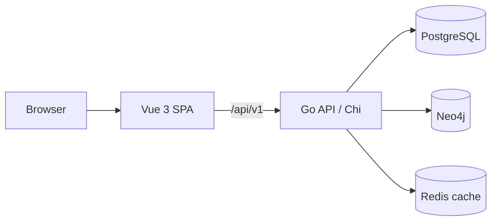

# Porta

Porta is an open-source Configuration Management Database (CMDB) for IT asset
management. It records configuration items and their relationships, adds an
Enterprise Architecture layer and an IT asset amortization module, and ships as a
Docker Compose stack.

Porta was previously named **Pustaka**; see the
[upgrade guide](docs/guides/upgrading-from-pustaka.md) if you are migrating an
installation. Not every screen is finished: read [docs/status.md](docs/status.md)
for the honest Implemented / Partial / Planned breakdown.

## Feature tour

- **CMDB core.** CI types define flat required/optional attribute schemas; CIs
  store JSONB attributes and tags. Lifecycle statuses (pending, active, terminal)
  drive amortization behavior. Relationship types define labels, cardinality, and
  allowed CI types; relationships live in PostgreSQL and are mirrored in Neo4j.
  The UI adds bulk relationship creation, a graph explorer, QR codes, and search.
- **Enterprise Architecture.** Eight domains: Strategy, Business, Application,
  Data, Technology, Infrastructure, Security, Governance. EA entities are
  `EA.<domain>-<type>` CIs grouped by EA team; validation blocks missing required
  attributes, and optional-attribute issues plus a data-quality score are
  recorded. There is a CSV import wizard and a data-quality dashboard.
- **Amortization.** Per-CI purchase cost, salvage value, amortization start date,
  useful life, and book value. Straight-line calculator, append-only ledger
  (monthly, catch-up, write-off, adjustment, and restructuring entries), manual
  runs with dry-run, and reports for OCC, GVB, NBV, and AD. Scheduled automation
  and automatic terminal-status write-offs are **Partial**: manual runs process
  assets, but no timer triggers the daily run.
- **Dashboards and audit.** Dashboard widgets for stats, health score and trend,
  data quality, asset aging, risk, and finances, backed by analytics endpoints for
  cycles, connectivity, growth, and usage. Audit logging with a filterable viewer,
  statistics, and CSV export.
- **Operations.** Docker Compose stack, GHCR images built by GitHub Actions,
  automatic migrations at API startup, JWT authentication with RBAC, and
  `/health`. Redis is a cache only; rate limiting and metrics are planned.

## Architecture at a glance



The frontend proxies `/api/v1` to the API, which applies migrations at startup and
enforces JWT authentication plus per-route RBAC.

| Service | Address |
| --- | --- |
| Frontend | http://localhost:3001 |
| API | http://localhost:8081 (health at `/health`) |
| Neo4j Browser | http://localhost:7475 |
| PostgreSQL | localhost:5433 |
| Redis | localhost:6380 |

## Quick start

You need Docker and Docker Compose; Go and Node.js are only needed for local
development.

```sh
git clone https://github.com/tahopetis/porta.git
cd porta
cp .env.example .env
make dev
```

`make dev` pulls the published images, starts the stack, and runs migrations (the
API also applies them on startup). Images are built by GitHub Actions, so the host
only pulls them; `make images-build` is the slow escape hatch for a local rebuild.

An administrator is created automatically at API startup with `admin` /
`Admin@123`; change the password after the first login.

## Configuration essentials

Copy `.env.example` to `.env` and set at least `DATABASE_URL`, `NEO4J_URL`,
`REDIS_URL`, and a `JWT_SECRET` of 32 or more characters. Variables are accepted
both unprefixed and with the `PORTA_` prefix; `.env.example` uses the unprefixed
form. The full variable table is in the
[configuration guide](docs/guides/configuration.md).

## Development

```sh
make build                 # build the API binary
make test                  # run all Go tests
make test-integration      # DB-backed suites (needs TEST_DATABASE_URL)
make fmt lint security     # formatting, linting, security scan

cd web
npm run dev                # frontend dev server
npm run test               # Vitest unit tests
npm run build              # production bundle
```

See [development](docs/guides/development.md) and
[testing](docs/guides/testing.md) for the rest of the story.

## Documentation

| Topic | Document |
| --- | --- |
| What works today | [docs/status.md](docs/status.md) |
| Installation and configuration | [docs/guides/installation.md](docs/guides/installation.md), [docs/guides/configuration.md](docs/guides/configuration.md) |
| System architecture and data model | [docs/architecture/overview.md](docs/architecture/overview.md), [docs/architecture/data-model.md](docs/architecture/data-model.md) |
| API reference and examples | [docs/architecture/api.md](docs/architecture/api.md), [docs/api/api-guide.md](docs/api/api-guide.md), [docs/api/api-examples.md](docs/api/api-examples.md) |
| Feature guides | [docs/features/cmdb.md](docs/features/cmdb.md) and the rest of `docs/features/` |
| Full documentation map | [docs/README.md](docs/README.md) |
| Agent guidance | [CLAUDE.md](CLAUDE.md), [GLOSSARY.md](GLOSSARY.md) |

## Migrating from Pustaka

The rename is a breaking change: environment variables moved to the `PORTA_`
prefix (unprefixed names still work), the database role and name changed, the JWT
issuer changed, and the Go module path is now `github.com/tahopetis/porta`.
Follow [docs/guides/upgrading-from-pustaka.md](docs/guides/upgrading-from-pustaka.md).

## Contributing

Fork the repository, create a branch, and open a pull request. Pull requests
trigger CI (build, tests, CodeQL, dependency review, and image builds), and
commits follow the conventional-commit style used in the history. Read the
[contributing guide](docs/guides/contributing.md) before you start.

## License

MIT. See [LICENSE](LICENSE).
