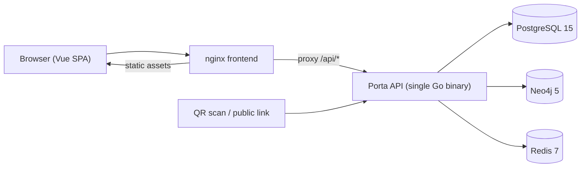

# Porta CMDB Architecture Overview

Porta is a self-hosted Configuration Management Database (CMDB) with an
Enterprise Architecture layer and an IT asset amortization module. It stores
configuration items (CIs) with a flexible JSONB attribute schema, models the
relationships between them as a graph, and exposes a REST API consumed by a Vue
single-page application.

The system is **one Go API binary, one frontend container, and three data
stores**. Packages under `internal/` are logical services inside the same
process, not independently deployable microservices.

Status terms used across this documentation set: **Implemented** (shipped and
wired), **Partial** (shipped but stubbed or limited), **Planned** (no code). See
[status.md](../status.md) for the project-wide matrix.

## Design principles

The implementation is **data-first and relationship-centric**: PostgreSQL is the
source of truth, relationships are first-class records mirrored into a graph
store, and Redis only accelerates reads. The API is the only data interface, and
authentication, authorisation, and audit trails are built into the request path.

## System context

There is no gateway tier and no message broker. The browser-facing entry points
are the frontend (which serves the SPA and proxies `/api/`) and the API itself;
the API also exposes `/health` and `/public/ci/{id}` directly.

## Deployment topology

Docker Compose defines five services under project `porta` on the private bridge
network `porta-network` (`172.26.0.0/16`). Images are built and published by CI;
a deployment host pulls them.

| Service | Image | Host -> container port | Role |
|---|---|---|---|
| `frontend` | `ghcr.io/tahopetis/porta-frontend` | 3001 -> 3000 | nginx serving the Vite build; proxies `/api/` to `porta-api:8080` |
| `api` | `ghcr.io/tahopetis/porta-api` | 8081 -> 8080 | Go HTTP API; migrations and admin bootstrap at startup |
| `postgres` | `postgres:15` | 5433 -> 5432 | Database `porta`, source of truth for structured data |
| `neo4j` | `neo4j:5-community` | 7475 -> 7474 (HTTP), 7688 -> 7687 (Bolt) | Graph store for CIs and relationships |
| `redis` | `redis:7-alpine` | 6380 -> 6379 | Cache only, password protected, AOF enabled |

`docker/nginx.conf` serves the SPA with history-mode fallback and forwards
`/api/` to the API over the Compose network; the frontend container is the normal
entry point.

## Backend stack

| Component | Version (`go.mod`) | Use |
|---|---|---|
| Go | 1.25 | Language and runtime |
| chi | v5.4.0 | HTTP router (live router in `cmd/api/main.go`) |
| pgx / neo4j-go-driver / go-redis | v5.9.2 / v5.28.6 / v9.6.3 | Data-store drivers |
| golang-jwt / argon2id | v5.3.1 / v1.0.0 | HS256 tokens, Argon2id password hashing |
| zerolog / viper / godotenv | v1.35.1 / v1.21.0 / v1.5.1 | Structured logging (`pkg/logger`), configuration |
| golang-migrate | v4.19.1 | Versioned SQL migrations |
| gorilla/mux | v1.8.1 | Used only by dead code (`internal/api/router.go`), not by the server |

Package responsibilities:

| Path | Responsibility |
|---|---|
| `cmd/api/main.go` | Composition root: config, databases, migrations, services, router, lifecycle |
| `internal/api` | Handlers for CI, CI types, relationships, graph, QR, audit; response helpers |
| `internal/api/handlers` | Auth, users, relationship types, lifecycle statuses, amortization, EA, imports, data quality |
| `internal/api/middleware` | JWT auth, RBAC, activity tracking, audit logging (structured logs), CORS, request logging |
| `internal/auth` | JWT service, Argon2id password service, RBAC data access |
| `internal/ci` | Core domain: repositories, service, Neo4j graph service, audit, lifecycle, relationship types, health score, aging, risk, data quality |
| `internal/amortization` | Depreciation calculator, ledger repository, run scheduler, service layer |
| `internal/ea` | EA services over `EA.*` CI types, validation, CSV import |
| `internal/database` | PostgreSQL/Neo4j/Redis connections and the migration runner |
| `internal/config` | Viper configuration with unprefixed and `PORTA_`-prefixed env bindings |
| `pkg/logger` | zerolog wrapper with audit/database helpers |

## Frontend stack

| Component | Version (`web/package.json`) | Use |
|---|---|---|
| Vue | 3.5 | Composition API SPA |
| TypeScript / Vite | 5.2 / 8.3 | Language, dev server, Rolldown production build |
| Pinia / Vue Router | 4.1 / 5.4 | State and client-side routing with permission guards |
| Tailwind CSS / Headless UI | 3.3 / 1.7 | Styling and accessible primitives |
| vis-network / ag-grid / d3 | 9.1 / 35.1 / 7.8 | Graph view, data grids, analytics charts |
| axios | 1.21 | API client in `web/src/services` |
| qrcode.vue / papaparse | 3.6 / 5.5 | QR rendering, CSV parsing |
| Vitest / Cypress / Playwright | 5.1 / 16.2 / 1.55 | Unit and end-to-end tests |

`web/vite.config.ts` serves port 3000 and proxies `/api` to
`http://localhost:8080` in development. In Compose, `VITE_API_URL` is `/api/v1`
so the browser calls the same origin and nginx proxies.

## Request pipeline

`setupRouter` (`cmd/api/main.go:340-715`) applies global middleware in order:

| Order | Middleware | Effect |
|---|---|---|
| 1 | `RequestID` | Adds/propagates `X-Request-ID` |
| 2 | `RealIP` | Rewrites `RemoteAddr` from forwarding headers |
| 3 | `Recoverer` | Converts panics into 500 responses |
| 4 | `Timeout(60s)` | Caps request handling time |
| 5 | `AllowContentType("application/json")` | Rejects non-empty bodies with a non-JSON content type (415); empty bodies skip the check |
| 6 | `CleanPath` | Normalises the path |
| 7 | custom `Logger` | Structured request logging |
| 8 | custom `CORS` | Origin/method/header allow-list, credentials allowed, 5-minute preflight cache |

Inside `/api/v1`, the protected group applies `JWTAuth` -> `ActivityTracker` ->
`AuditLogging`, then per-route-group `RBAC`, then the handler. The activity
tracker updates `users.last_active` in the background after a 2xx response; the
audit middleware emits structured log entries (it does not write `audit_logs`
rows — services do that). `/api/v1/auth/*`, `/health`, and `/public/ci/{id}` sit
outside the protected group.

RBAC is mounted on route groups (for example `user:read` on `/users`) and nested
write groups add a second permission, so writes require **both** permissions.
Checks are exact string matches against the token's `permissions` claim.

## Authentication and authorisation

- **Login**: `POST /api/v1/auth/login` with username and password; the API
  verifies an Argon2id hash and returns `access_token`, `refresh_token`,
  `token_type` (`Bearer`), `expires_in`, and the user with roles/permissions.
- **Tokens**: HS256 JWTs. Default TTLs are 24h access and 168h refresh
  (`internal/config/config.go:183-184`), overridable with
  `JWT_ACCESS_TOKEN_TTL`/`PORTA_JWT_ACCESS_TOKEN_TTL` and their refresh
  counterparts. Access claims carry `user_id`, `username`, `email`, `roles`,
  `permissions`; issuer `porta`, audience `porta`. Refresh tokens carry the
  subject and audience `porta-refresh`.
- **Refresh**: `POST /api/v1/auth/refresh` validates the refresh token, reloads
  the user and permissions from PostgreSQL, and returns a new token pair
  (rotation). There is no revocation list or server-side session, so an issued
  access token stays valid until expiry even if the user is deactivated.
- **Passwords**: Argon2id hashes with generated salts (`internal/auth/password.go`).
- **RBAC data**: roles `admin`, `editor`, `viewer`; permissions are
  `resource:action` strings seeded by migrations. See
  [data-model.md](data-model.md) for the seeded set and gaps.

## Storage model

| Store | Owns | Notes |
|---|---|---|
| PostgreSQL | Users, roles, permissions, CI types, CIs (JSONB attributes/tags), relationship rows, relationship types, lifecycle statuses, audit logs, amortization tables, health score history, EA teams | Source of truth; schema applied from `cmd/migrations` at startup |
| Neo4j | `ConfigurationItem` nodes and relationship edges | Mirrors relationship rows for traversal (graph, cycles, impact, most-connected). Sync happens after the PostgreSQL write and is best-effort: failures are logged, not fatal (`internal/ci/service.go:402-413`) |
| Redis | Cache entries | CI reads (5-minute TTL, invalidated on write), active relationship types, lifecycle statuses, amortization cache. No sessions, rate-limit counters, or job queues |

Relationships are persisted twice: authoritatively as `relationships` rows and as
graph edges in Neo4j; PostgreSQL remains the recovery source for the graph.

## Startup, shutdown, and background work

Startup (`cmd/api/main.go`): load config and logger; connect to PostgreSQL;
attempt admin bootstrap (skipped on a fresh database); run pending migrations;
bootstrap/refresh the admin user and assign the `admin` role; connect to Neo4j,
initialise indexes, then Redis; build services, handlers, and router; start the
amortization scheduler goroutine; serve HTTP. On `SIGINT`/`SIGTERM` it stops the
scheduler and shuts down with a 30-second timeout.

| Work | Status | Evidence |
|---|---|---|
| Migrations and admin bootstrap on boot | Implemented | `cmd/api/main.go:146-166`; migrations from `cmd/migrations` |
| Daily amortization scheduler | **Partial (log-only stub)** | `internal/amortization/scheduler_simple.go:37-41` only logs; no ticker or cron starts. Manual runs via `POST /api/v1/amortization/runs` do execute |
| Terminal-status write-off hook | **Partial (unwired)** | `HandleTerminalStatusChange` exists in `internal/amortization/service.go:269` but has no caller; write-offs only occur inside a run |
| CI / catalogue caches | Implemented | Explicit invalidation on writes |
| CMDB health score history | Implemented | Computed on request and inserted into `health_score_history` (`internal/ci/repository.go:1140-1163`) |
| Prometheus `/metrics` | Planned | `cmd/api/main.go:384-388` is a TODO; no `METRICS_*` env binding is registered |
| Job queue / workers | Planned | No broker or worker package exists |

`/health` returns a static JSON body with a timestamp; it does not probe the
data stores (`cmd/api/main.go:378-382`).

## Routing caveat

`internal/api/router.go` still builds a gorilla/mux router mounting a subset of
the same handlers, but nothing calls it — the server uses chi. Handlers in
`internal/api` read path parameters through `mux.Vars` with a fallback that
extracts a trailing UUID from the path (`internal/api/handlers.go:36-57`);
handlers in `internal/api/handlers` use `chi.URLParam`. This works only when the
path ends in the identifier; the affected live route is recorded in
[api.md](api.md).

## Related documentation

- [Documentation index](../README.md)
- [Project status](../status.md)
- [Data model](data-model.md)
- [API reference](api.md)
- [Installation](../guides/installation.md), [configuration](../guides/configuration.md), [development](../guides/development.md), [testing](../guides/testing.md)
- [ADR-0001: rename Pustaka to Porta](../adr/0001-rename-pustaka-to-porta.md)
